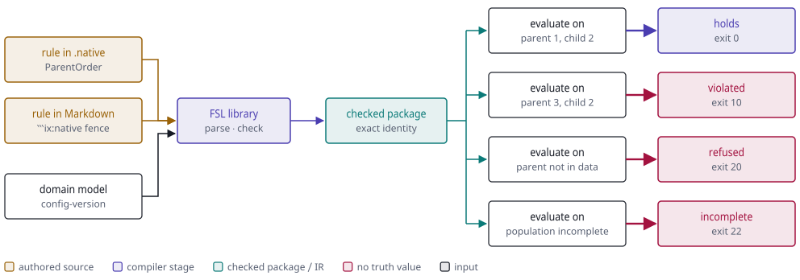
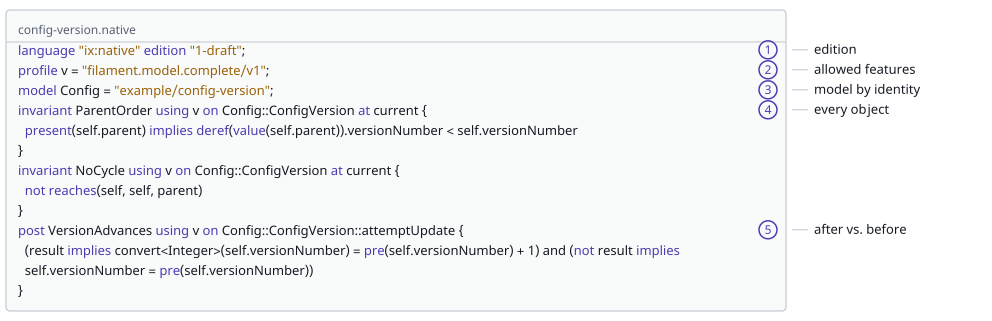
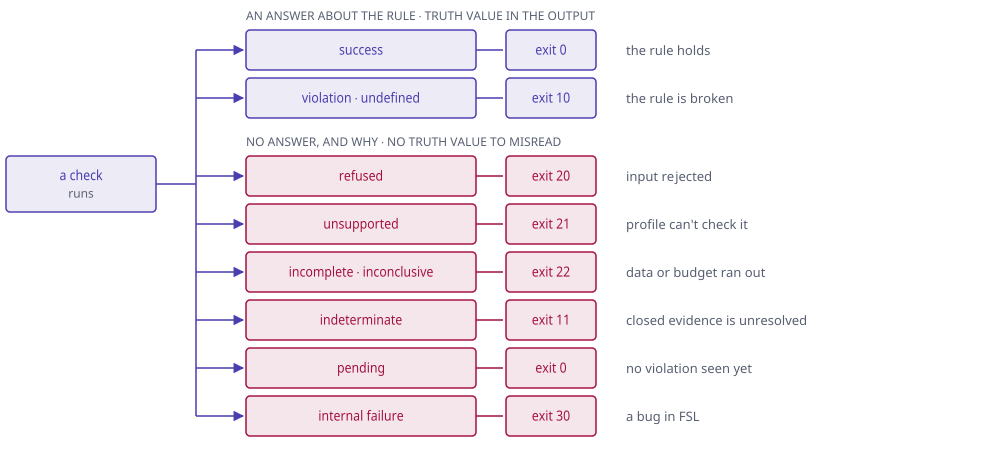
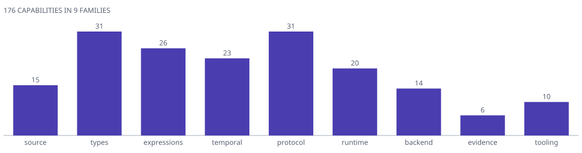
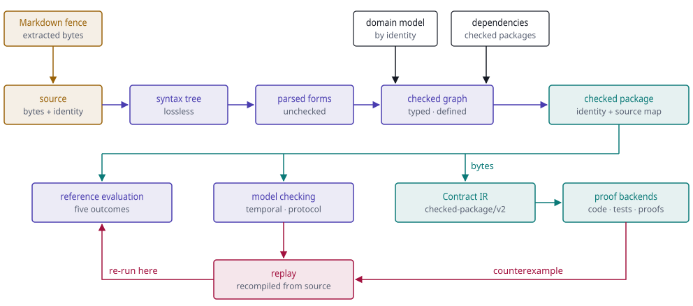
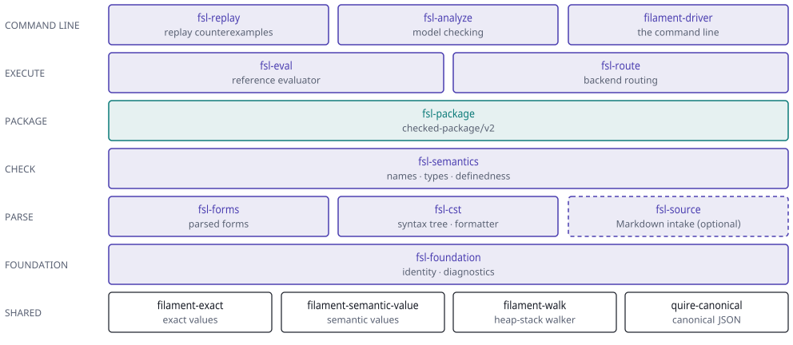

# Filament Specification Language

[](https://discord.gg/k8DVhuYBR2)

FSL (Filament Specification Language) is a formal language for rules about a
system's data and behavior. This repository contains its compiler library,
and its reference evaluator.

The compiler checks a rule against a domain model and writes a checked package.
The evaluator runs a checked rule against data and returns one of five
outcomes: holds, violated, refused, unsupported or incomplete. Proof and
code-generation backends read the same checked package.

<picture>
  <source media="(prefers-color-scheme: dark)" srcset="docs/images/hero-dark.svg">
  
</picture>

> **Status: public prerelease.** The language, its editions and every API here
> are still changing. No crate is published yet. Expect breaking changes.

## A first rule

This unit states three rules about the `ConfigVersion` objects of the domain
model `example/config-version`:

<picture>
  <source media="(prefers-color-scheme: dark)" srcset="docs/images/first-rule-dark.svg">
  
</picture>

```
language "ix:native" edition "1-draft";
profile v = "filament.model.complete/v1";
model Config = "example/config-version";

invariant ParentOrder using v on Config::ConfigVersion at current {
  present(self.parent) implies deref(value(self.parent)).versionNumber < self.versionNumber
}

invariant NoCycle using v on Config::ConfigVersion at current {
  not reaches(self, self, parent)
}

post VersionUnchanged using v on Config::ConfigVersion::attemptUpdate {
  self.versionNumber = pre(self.versionNumber)
}
```

- **`language … edition`** sets the language version of the file.
- **`profile`** selects the part of the language the rules may use.
  `filament.model.complete/v1` covers values, object graphs and model operations.
  The line binds it to the name `v`, and each rule says `using v`.
- **`model`** imports the domain model by identity.
  A rule is checked against the model with that identity.
- **`invariant … at current`** must hold for every `ConfigVersion` in the data.
  `ParentOrder`: a parent, when present, has a lower version number.
  `self.parent` is an optional reference; `present` tests it, `value` unwraps
  it and `deref` follows it. `NoCycle`: following `parent` links never returns
  to the start.
- **`post … on …::attemptUpdate`** is checked around an operation. `pre(x)` is
  the value of `x` before the operation. `VersionUnchanged`: an update attempt
  keeps the version number.

### Rules in Markdown specs

A rule can also sit in an `ix:native` fenced block in a Quire Markdown spec,
under the prose it formalizes:

````markdown
### ParentOrder

A version's parent, when it has one, always has a lower version number.

```ix:native
invariant ParentOrder using v on Config::ConfigVersion at current {
  present(self.parent) implies deref(value(self.parent)).versionNumber < self.versionNumber
}
```
````

The optional `fsl-replay/quire-extraction` feature reads the block's bytes from
the Markdown file through `fsl-source`, using
[quire-rs](https://github.com/agent-ix/quire-rs), and keeps a source map to the
document. Errors are reported at their line and column in the Markdown file.
This is a library API; the `run` command does not yet accept Markdown for
`1-draft` rules.

## Outcomes

Every check ends in one outcome, and the process exit code matches it:

<picture>
  <source media="(prefers-color-scheme: dark)" srcset="docs/images/outcomes-dark.svg">
  
</picture>

| Outcome | Exit | Meaning |
| --- | --- | --- |
| success | 0 | The check completed and the rule holds. |
| violation, undefined | 10 | The check completed and the rule is broken, or the rule asked for a value that is not defined. |
| refused | 20 | The input was rejected before any rule ran: bad syntax, a wrong model identity, a malformed request. |
| unsupported | 21 | The construct is valid FSL, but the selected profile or backend cannot check it. |
| incomplete, inconclusive | 22 | Data was missing or the work budget ran out. |
| indeterminate | 11 | A finite-window clause whose window is closed and whose evidence is still missing or conflicting: neither held nor broken. |
| pending | 0 | A clause still pending when its trace ends: no violation was observed, and the report lists the pending clauses. |
| internal failure | 30 | A bug in FSL. |

Only success and violation carry a truth value. Refused and incomplete results
have no truth field in their output. Every result names the source, model and
input it was computed from.

## Language

Each unit declares its profiles. Each profile enables one family of rules. All
of the families below are in the `1-draft` edition. In the excerpts, `G`, `T`
and `P` are profiles and `M` is a model, declared at the top of the unit as in
the first example.

**Values and functions.** Bounded integers, exact rationals, records, unions
and pure functions. There is no floating point.

```
type Digit = Int[0, 9];
record Point { x: Digit; y: Digit; }
function px using v(p: Point): Digit pure { if p.x > p.y then p.x else p.y }
```

**State.** Invariants over the current objects, `pre`/`post` rules around
operations, and sums and sizes over collections.

```
invariant Healthy using G on M::Workflow at current {
    size<M::Tally>(self.receipts) <= 5
    and sum<M::Total>(receipt in self.receipts: receipt) <= self.total
}
```

**Time.** Temporal rules over a sequence of events, with explicit clocks and
bounded windows. This one says the ratio stays allowed for the 30 events after
the origin:

```
temporal Due using T over (view: M::Workflow) clock "events" on origin {
    always[0,30] holds(Allowed(view.ratio))
}
```

**Protocols.** Choreographies between services: roles, channels with ordering
and delivery bounds, sequences, choices, parallel branches, retries, timeouts
and compensation. An excerpt:

```
protocol Orders using P over (view: M::WorkflowView) on each (started: M::StartView) when (started.ready) {
  role OrdersService on M::OrderService;
  role PaymentsService on M::PaymentService;
  channel Requests from OrdersService to PaymentsService carries M::ChargeRequest
    ordering fifo by (message: M::ChargeRequest) { message.key } delivery [0,3];
  run sequence Main {
    send Sent via Requests as (sent: M::SendView) { sent.amount = requested };
    receive Received via Requests of Sent as (received: M::ReceiptView) { received.ok };
    commit Committed by OrdersService as (committed: M::CommitView) { committed.ok };
  }
}
```

| Profile | Family |
| --- | --- |
| `filament.value.complete/v1` | values, records, functions, predicates |
| `filament.state.graph/v1` | invariants, `pre`/`post`, reachability over object graphs |
| `filament.temporal.event-position.false-extension/v1` | temporal rules over event positions |
| `filament.temporal.timestamped-event.finite-window/v1` | temporal rules over timestamped events in a finite window |
| `filament.temporal.fixed-sample.false-extension/v1` | temporal rules over fixed-rate samples |
| `filament.temporal.infinite-trace/v1` | temporal rules over unbounded traces (model checking) |
| `filament.protocol.finite-global/v1` | protocols between roles |

The `1-draft` language is a closed list of capabilities in nine families. FSL
checks every package against that list.

<picture>
  <source media="(prefers-color-scheme: dark)" srcset="docs/images/capabilities-dark.svg">
  
</picture>

**Editions.** This README covers the `1-draft` edition, the complete version-1
language. The retired `0-draft` edition is refused by `compile`, and its
historical parser is deleted. Do not write new rules in it.

## Compiler stages

FSL compiles in stages. Each stage consumes the previous stage's output type
and produces a new one. Unchecked and checked rules are different Rust types,
so unchecked input cannot reach an evaluator or backend.

<picture>
  <source media="(prefers-color-scheme: dark)" srcset="docs/images/pipeline-dark.svg">

</picture>

| Stage | Guarantees |
| --- | --- |
| **Source** | Exact bytes with an identity: authority, id and revision. Markdown fences enter here. |
| **Syntax tree** | A byte-exact tree of the source, including comments and spacing. The formatter works from it. A file that parses is not yet checked. |
| **Parsed forms** | One unchecked form per declaration, each with its source span. |
| **Checked graph** | Every name is resolved against the imported domain model and dependency packages. Every expression is typed. Every partial operation, such as a division or a dereference, is proved defined or becomes an explicit runtime obligation. |
| **Checked package** | The checked rules and their dependencies' checked rules, with a package identity and a source map. It can be written as `filament.checked-package/v2` bytes. |
| **Reference evaluation** | Deterministic, side-effect-free execution against supplied data. Ends in one of the outcomes above. |
| **Model checking** | In-process engines for temporal and protocol rules: model checking, timed-zone search, schedulability and probabilistic analysis. |
| **Proof backends** | [Contract IR](https://github.com/agent-ix/filament-contract-ir) reads the v2 bytes. [Contract codegen](https://github.com/agent-ix/filament-contract-codegen) generates code, property tests and bounded proofs from it. |
| **Replay** | A counterexample from any engine is recompiled from its source and re-run on the reference evaluator. A backend's "violated" result is accepted only if the reference evaluator returns the same outcome. |

## Usage

Install Rust at or above the `rust-version` in `Cargo.toml`. No other tools or services are needed.

```sh
git clone https://github.com/agent-ix/filament-spec-language
cd filament-spec-language
cargo build --locked --workspace
```

The main FSL interface is a library. The separate
[`fsl-probability-check`](tools/fsl-probability-check/README.md) developer-tool executable checks
exact reachability certificate documents against supplied source and data.
The `fsl` command line is in
[filament-driver](https://github.com/agent-ix/filament-driver), whose verbs call the
library API described here.

**Format.** `fsl_cst::format::format` takes an admissible parsed source and
returns the formatted source; it leaves the file unchanged. Parse the bytes
with `fsl_cst::parse`, which takes the source identity (authority and id)
that every diagnostic carries.

**Run a rule against data.** The ConfigVersion example writes one directory per
case, holding the unit from [A first rule](#a-first-rule), its domain model and
a snapshot of `ConfigVersion` objects. `requests.sh` writes a `run.json`
`native-run/1` request that checks one rule for the object keyed `child`, and
The non-core `fsl_command::command::run` library entry executes it:

```sh
cargo run --locked --example config_version_fixtures -- /tmp/config-version
examples/config-version/requests.sh /tmp/config-version/healthy-parent ParentOrder
```

```rust
use fsl_command::command;

let result = command::run(std::path::Path::new("/tmp/config-version/healthy-parent/run.json"))?;
// `result.value` is the JSON result document; `result.exit_code` is the code
// FR-285 gives its category.
println!("exit {}", result.exit_code);
```

`command::run_with_limits` takes the request-file and dependent-file byte
ceilings, and a refusal is a `RunError` whose `category().exit_code()` is the
code and whose `value()` is the refusal envelope. The test
`walkthrough_requests_reproduce_the_documented_exit_codes` in
`tests/it/config_version_spine.rs` runs every case below this way:

| Case | Data | Outcome | Exit |
| --- | --- | --- | --- |
| `healthy-parent` | parent version 1, child version 2 | the rule holds | 0 |
| `violating-parent` | parent version 3, child version 2 | the rule is broken | 10 |
| `dangling-parent` | the parent is not in the snapshot | refused | 20 |
| `incomplete-population` | the snapshot's population is not complete | incomplete | 22 |

`requests.sh /tmp/config-version/cycle NoCycle` checks the other invariant; the
`cycle` case breaks it (exit 10).

**Compile a rule.** `requests.sh` also writes `compile.json`, a `native-compile/1`
request. `command::compile` accepts only `1-draft` sources and returns the
checked package as `filament.checked-package/v2` bytes; a source that declares any
other edition, including `0-draft`, is refused with `unknown_edition`:

```rust
let package: Vec<u8> =
    command::compile(std::path::Path::new("/tmp/config-version/healthy-parent/compile.json"))?;
```

**Emit package bytes from a source file.** `compile` needs a request file with
source labels. For a downstream reader that wants the bytes of one `1-draft`
source, the `emit_checked_v2` example takes the files directly and calls the
same producer (`fsl_replay::compile_package`), so the bytes follow the
producer. Pass each domain package document the
source's `model` declarations select with `--model`, and each imported library
as `--library <identity>=<file>`. The bytes go to stdout, or to `--out <path>`.
Every failure (usage, unreadable file, write failure, refusal) writes no
bytes, prints a diagnostic on stderr that tells them apart, and exits with the
refusal category's code 20, as the `fsl` driver does; a producer refusal whose
catalog code is in another category (for example incomplete) exits with that
category's code (22). The emitted bytes embed the source path exactly as given
(the `source:<path>` label feeds the source labels and the
package identity), so pass an identical, fixed, cwd-relative path on every
invocation to get stable bytes. The source is read under the source-size ceiling (a longer source is the
producer's size refusal, exit 22, with its `--limit` hint removed because this
tool has no such flag); a `--model`, `--library` or `--execution-points` file over the
ceiling is an explicit refusal naming the file (exit 20), never truncated.

```sh
cargo run --locked --example emit_checked_v2 -- \
  --package-name switch \
  --model examples/switch-transition/switch.semantic-ir.json \
  examples/switch-transition/switch.native > package.json
```

The package is read back with the same domain documents as evidence
(`CheckedPackageEvidence::insert_domain_package_document`).

**Accepted execution points.** `--execution-points <file>` supplies accepted
state-clause execution points (FR-104-AC-15) through the producer's
`check_with_execution_points` (`fsl_replay::compile_package_with_execution_points`),
so the emitted state clauses carry them. The file is a JSON object from the
exact authored clause name to an execution point: `{"kind": "initialization" |
"handler", "name": "<anchor>"}` or `{"kind": "pre" | "post", "operation":
"<anchor>"}`. For example, `{"After": {"kind": "post", "operation": "probe"}}`
accepts the point for `post After ... on X::Y::probe`. A malformed file is a
refusal naming it; a point for no authored clause, or one the clause kind does
not accept, is the checker's refusal. The points file is read under the same
file ceiling as a `--model` file (over it is an explicit refusal, never
truncated). A repeated clause name, an empty object, a member the point does
not define and an unknown `kind` are each a refusal naming the file (a
malformed anchor name is the checker's refusal instead); an
empty object is refused rather than emitting point-free bytes, since passing
the option means points are expected. In every refusal no bytes are written and
the exit is nonzero. Without the option the clauses are point-free.

**Clock selections.** `--clock-selections <file>` supplies the clock
configuration of each `temporal` clause or `compensate` template whose profile
takes one (FR-517), so the package carries its `temporal_bindings` rows. The
file is a JSON object from the exact authored clause or template name to a
clock configuration in the `TemporalBinding` `clock` wire form, for example
`{"Due": {"kind": "event_position", "sequence_authority": "events"}}`,
`{"DueSample": {"kind": "fixed_sample", "epoch": {"kind": "integer",
"decimal": "0"}, "period": {"kind": "rational", "numerator": "1",
"denominator": "10"}, "unit": "milliseconds"}}` or `{"DueTimestamp": {"kind":
"timestamped_event", "timestamp_unit": "rfc3339"}}`. It is read under the same file ceiling; an empty object, a
repeated name, an unknown `kind`, a member the configuration does not define
and a missing member are each a refusal naming the file, and a name that matches no clause or
template is refused before any bytes are emitted.

The [ConfigVersion example](examples/config-version/README.md) lists all
seventeen cases: parents, cycles, object identity, operation frames, and refused
and incomplete runs. `run` can also evaluate one pure function;
[`tests/it/spine_run.rs`](tests/it/spine_run.rs) shows that request.

**Optional features.**

| Feature | Adds |
| --- | --- |
| `fsl-replay/quire-extraction` | Enables FSL's replay library to read rules from Quire Markdown spec artifacts, with locations mapped to the document. |
| `population-fixtures` | Writes the population fixtures used by the admission tests. |

FSL builds no command line of its own. `fsl` from [filament-driver](https://github.com/agent-ix/filament-driver)
serves parse, format, run and compile, running FSL, Contract IR and the
backends as one tool.

## The Filament ecosystem

The standard defines the language. FSL compiles rules into checked packages.
Contract IR turns them into contracts for code generation, the runtime and the
analyzers. The driver runs the chain. All of them use a set of shared `no_std` libraries.


<picture>
  <source media="(prefers-color-scheme: dark)" srcset="docs/images/ecosystem-dark.svg">
  
</picture>

| Repository | Role | Relation to FSL |
| --- | --- | --- |
| [filament-specification](https://github.com/agent-ix/filament-specification) | The language standard: rule semantics, profiles, interchange formats and the conformance tests. | FSL implements it; `make ci` checks FSL against its test vectors. |
| [filament-exact](https://github.com/agent-ix/filament-exact) | Exact numbers and closed outcomes; `no_std`. | FSL depends on it. |
| [filament-semantic-value](https://github.com/agent-ix/filament-semantic-value) | Semantic values with their origin, built on filament-exact; `no_std`. | FSL depends on it. |
| [filament-walk](https://github.com/agent-ix/filament-walk) | Walks deep trees on a heap stack; `no_std`. | FSL depends on it. |
| [quire-canonical](https://github.com/agent-ix/quire-canonical) | Canonical JSON (RFC 8785). | FSL depends on it. |
| [filament-contract-ir](https://github.com/agent-ix/filament-contract-ir) | The target-neutral contract model that backends use. | FSL depends on its model crate; IR reads FSL's checked packages. |
| [filament-contract-codegen](https://github.com/agent-ix/filament-contract-codegen) | Generates Rust, property tests, bounded proofs and evidence from contracts. | Depends on FSL to replay counterexamples. |
| [filament-contract-runtime](https://github.com/agent-ix/filament-contract-runtime) | The `no_std` runtime for generated checks. | Used by codegen's output. |
| [filament-analyze](https://github.com/agent-ix/filament-analyze) | SMT-based consistency and implication checks across contracts. | Works on Contract IR. |
| [filament-verification-contracts](https://github.com/agent-ix/filament-verification-contracts) | The verification record types the tools exchange. | Used by IR, codegen and the standard. |
| [filament-observation](https://github.com/agent-ix/filament-observation) | Turns raw signals into qualified observations for rule evaluation. | Supplies data for temporal checks. |
| [filament-mltl](https://github.com/agent-ix/filament-mltl) | Connects the MLTL temporal-logic engine to filament-observation. | No direct dependency. |
| [filament-protocol](https://github.com/agent-ix/filament-protocol) | Checks running systems against compiled protocols, including compensation. | Consumes FSL's compiled protocols. |
| [filament-verification](https://github.com/agent-ix/filament-verification) | Selects verification techniques and plans for each requirement. | No direct dependency. |
| [filament-driver](https://github.com/agent-ix/filament-driver) | The `fsl` command line that runs the whole chain. | Depends on FSL. |
| [filament-integration](https://github.com/agent-ix/filament-integration) | Fixes a working set of versions and tests the chain together. | Depends on FSL. |

## Crates

The compiler is a Cargo workspace in strict layers. A crate depends only on
layers below it; `make arch-lint` enforces this.

<picture>
  <source media="(prefers-color-scheme: dark)" srcset="docs/images/layers-dark.svg">
  
</picture>

| Crate | Contents |
| --- | --- |
| `fsl-foundation` | Source identity, source maps, diagnostics and exit codes, wire-format names. |
| `fsl-cst` | Lexer, grammar, the lossless syntax tree and the formatter. |
| `fsl-forms` | Parsed, unchecked forms for each declaration family. |
| `fsl-semantics` | Model intake, name resolution, type checking and definedness proofs. The largest crate. |
| `fsl-package` | Checked packages and the `filament.checked-package/v2` writer and reader. |
| `fsl-eval` | The reference evaluator, including temporal automata and finite simulation. |
| `fsl-route` | Matches a package's requirements to the backends that can check it. |
| `fsl-analyze` | In-process model checking, timed zones and schedulability. |
| `fsl-conformance` | Shared library lifecycle cases and expected outcomes for driver conformance tests; see [outcome parity](docs/outcome-parity.md). |
| `fsl-inspect` | Typed package and result views, rendered as bounded JSON, text or DOT. |
| `fsl-replay` | Recompiles and re-runs counterexamples; codegen calls it. |
| `fsl-source` | Reads rules from Quire Markdown; its `quire-extraction` feature is enabled by `fsl-replay/quire-extraction`. |
| `fsl-string-edge` | The FR-064 string-edge scanner (library and `fsl-string-edge` command) that FSL's `xtask string-edge` and consumer repositories run; see [`fsl-string-edge/README.md`](fsl-string-edge/README.md). |
| `fsl-walk-grow`, `fsl-bench` | Deep-recursion stack growth, benchmarks. |
| root crate | The library facade. |
| `xtask`, `tools/arch-lint` | Repository checks: dependency direction, API surface, qualification and refinement. |

Other directories:

- [`spec/`](spec/): requirements. Each requirement, acceptance criterion and
  test case is a Markdown file. Tests are tagged with the criteria they check.
- [`spec/decisions/`](spec/decisions/): architecture decisions, including the
  stage design.
- [`docs/`](docs/): reference pages, including the
  [library notes](docs/library-notes.md),
  [diagnostic codes](docs/native-error-codes.md).

## Contributing

`make ci` is the local gate: formatting, clippy, tests across feature
combinations, docs and the architecture lints. It reads the standard's test
vectors from a sibling `filament-specification` checkout (`FSPEC_DIR`). The hosted
native compiler CI runs only on manual dispatch, so run the gate before opening
a pull request.
See [CONTRIBUTING.md](CONTRIBUTING.md) and [AGENTS.md](AGENTS.md).

Contributions require the [CLA](CLA.md).

## License

FSL is licensed under [AGPL-3.0-or-later](LICENSE). Fixtures keep their
`AGPL-3.0-only` headers.
